<p align="center">
  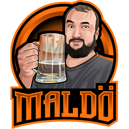
</p>

<h1 align="center">Stream Toolz by Maldö</h1>

<p align="center">
  <b>Tools for streamers, fully on your own PC. Free, no account with us, no tracking.</b>
</p>

<p align="center">
  <a href="https://github.com/nfMalde/stream-toolz/releases"></a>
</p>

<p align="center">
  <a href="#installing">How to install</a> · <a href="#the-modules">The modules</a> · <a href="docs/">Docs</a>
</p>

<p align="center">
  
  
  
  <a href="https://github.com/nfMalde/stream-toolz/releases"></a>
  <a href="LICENSE"></a>
  <a href="https://www.paypal.com/donate/?hosted_button_id=SVZHLRTQ6H4VL"></a>
  <a href="https://www.twitch.tv/maldoe"></a>
</p>

Stream Toolz is one app with six modules for your Twitch stream: a voice that reads your chat, countdowns you type in
plain words, a chat overlay, alerts, channel points sounds and a chat bot. Switch on what you use. Everything runs on
your own computer: no cloud, no account with us, no ads, and nothing of yours leaves the PC.

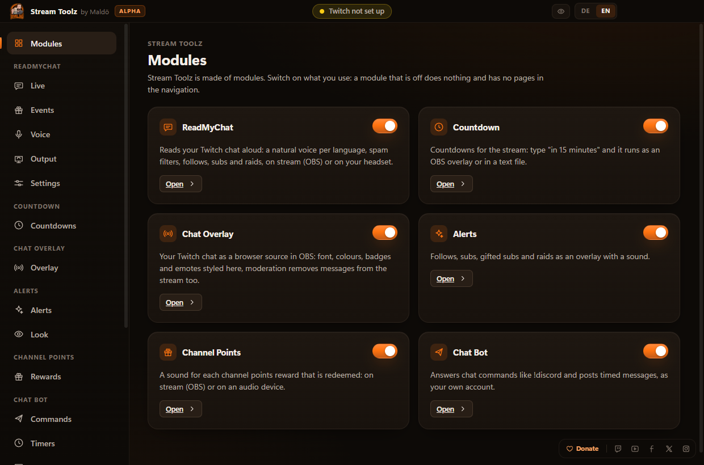

## How it works

1. **Install Stream Toolz** on your Windows PC ([Installing](#installing)).
2. **Connect your Twitch channel** with your own Twitch app: a code, confirmed on twitch.tv, done. The setup assistant
   walks you through it in about five minutes, and you only ever give the app's Client ID, never a secret or password.
3. **Add the browser sources to OBS** that the modules give you, and go live. The chat is read aloud, the overlays
   show, the bot answers.

## The modules

Every module has its own pages in the app and does nothing while it is off. ReadMyChat is on at the first start; the
others wait on the Modules page until you want them.

### ReadMyChat: your chat, read aloud

A natural voice reads every message, so you never miss the chat while you play.

- **Natural voices, offline.** Piper voices in German (Ramona, Eva K, Jan) and English (Cori, LJSpeech, Kristin,
  Norman, John), downloaded inside the app and running on your PC, or the voices built into Windows without any
  download. Only voices under standard open licenses with clean training data.
- **German and English in one chat.** The language of each message is detected, and the voice for that language reads
  it: "Anna sagt …", "Ben says …". Messages without a clear language ("gg") use your main language. More languages are
  a [language pack](docs/modules/readmychat-language-packs.md) away: one file plus a voice.
- **Two outputs.** An **OBS browser source**, so the voice is only in the stream with its own fader in the OBS mixer,
  or **any audio device** (your headset, a virtual cable).
- **Twitch events, read before the chat.** Follows, subs (Prime told apart), resubs with their message, gifted subs and
  raids, each with your own words or the default ones. Follow bots stay short: each person once, at most five follows a
  minute.
- **Reads what you want.** A pause between messages; the name in front of every message, only when the speaker changes,
  or never; long messages cut at a word; a queue that drops the oldest messages when the chat is too busy; no gap
  between messages, because the next one is rendered while the current one plays.
- **Moderation is followed.** A message a mod deletes is taken out of the queue or stopped while it is read; timeouts
  and bans remove that person's messages.
- **Spam filters, each one adjustable:** bots, `!commands`, duplicates, a limit per person, links, emote-only messages,
  blocked words, repeated characters. Optional: only subs/VIPs/mods, or only a channel points reward.
- **Nicknames and pronunciation:** "xx_dark_lord_xx = Lord", "gg = good game".
- **System-wide shortcuts** for pause, skip and clear, also while a game has the focus (F13–F24 work well with a
  Stream Deck).

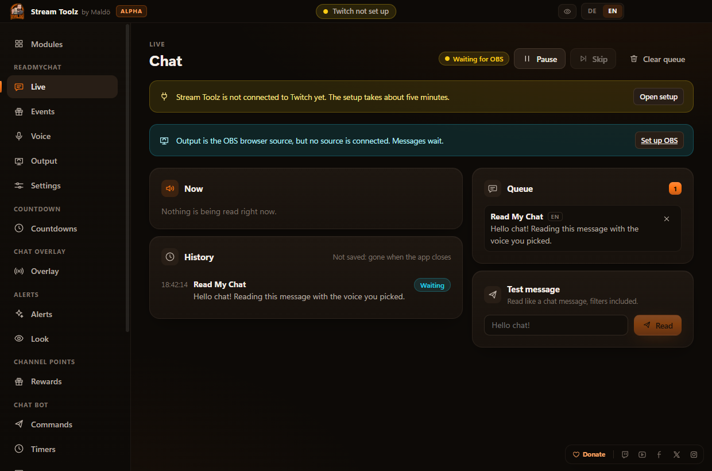

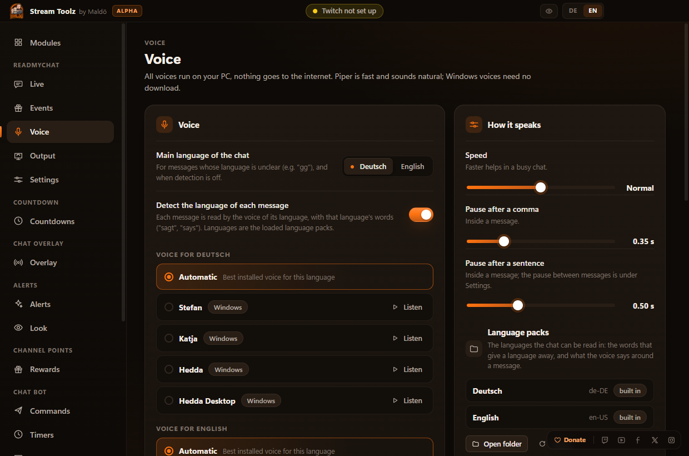

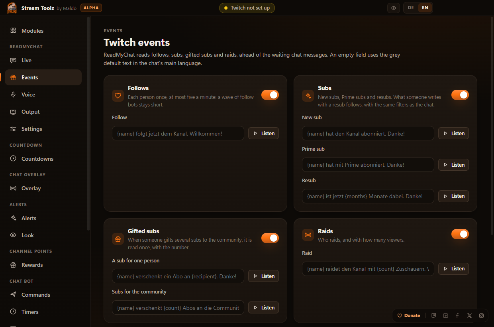

### Countdown: type it, see it in OBS

Type what you mean and the countdown runs: **"in 15 Minuten"**, **"until 20:30"**, **"1h30 giveaway"**, **"half an
hour"**, **"5 Minuten Pause"**. German and English, numbers as words too, understood on your PC without any service.

- **Two outputs.** A **browser source** for OBS with font, size, colour, alignment and shadow set in the app, or
  **text files** (`countdown.txt`, `countdown-1.txt`, one per label) that an OBS text source reads, so OBS controls
  the font. Or both.
- **Up to ten at once**, each with pause, −1/+1 minute and its own label; they survive a restart of the app.
- **At zero** the countdown stays until you remove it, or disappears by itself after a time you set; optionally with
  your own text at zero ("Go!").

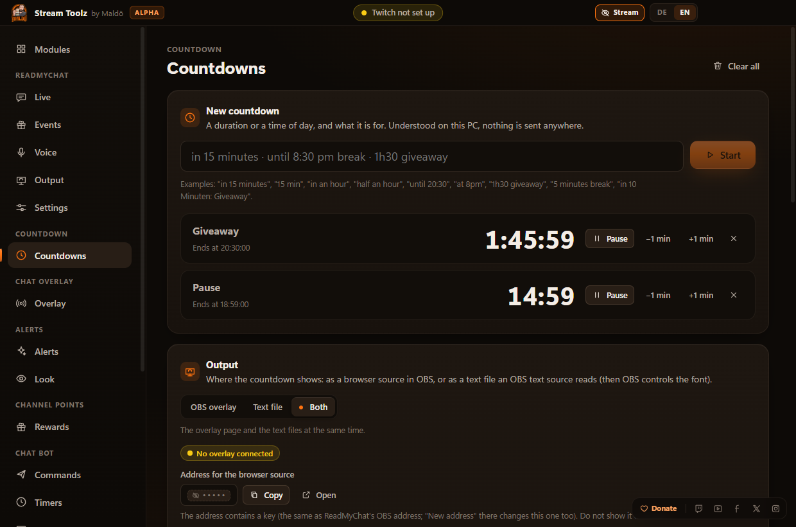

### Chat Overlay: the chat in the stream

Your chat as a browser source, styled in the app with a live preview.

- **Your look:** font, size, colours, the overlay's width, newest message at the bottom or the top, messages that fade
  after a while or stay.
- **Badges and colours:** streamer, mod, VIP and sub marks, and each chatter's Twitch colour or one colour for all.
- **Emotes** as text, or as pictures if you want them (OBS loads those from Twitch).
- **Clean:** commands and bots can be hidden; a message a mod deletes disappears from the stream too; follows, subs and
  raids can show as one-line notices.

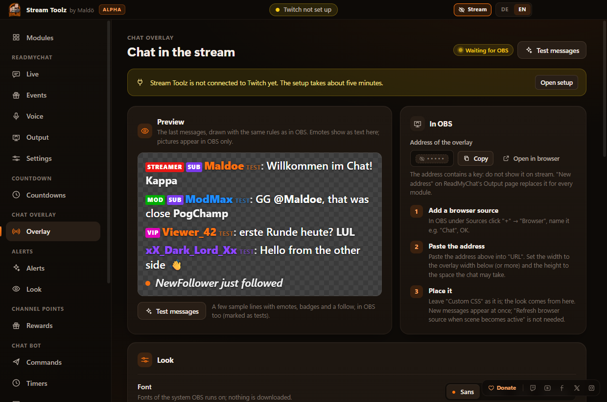

### Alerts: every follow, sub and raid on screen

Follows, subs, Prime subs, resubs with their message, gifted subs, community gifts and raids as an overlay, one after
the other, each with its own text and sound.

- **Your sounds:** WAV, MP3 or OGG files you pick; they are copied into the app's folder and played by the browser
  source in OBS, with their own fader there. Optionally also on an audio device, so you hear them yourself.
- **Your words:** a text per event with placeholders for the name, the count, the months, the recipient and the tier.
- **Calm on busy days:** more follows than you allow per minute are shown as one line ("… and 3 more"); raids below a
  size of your choice are skipped.
- **Your look:** size, font, colours, position (top, centre, bottom), animation (fade, slide, pop), and a test button
  for every event.

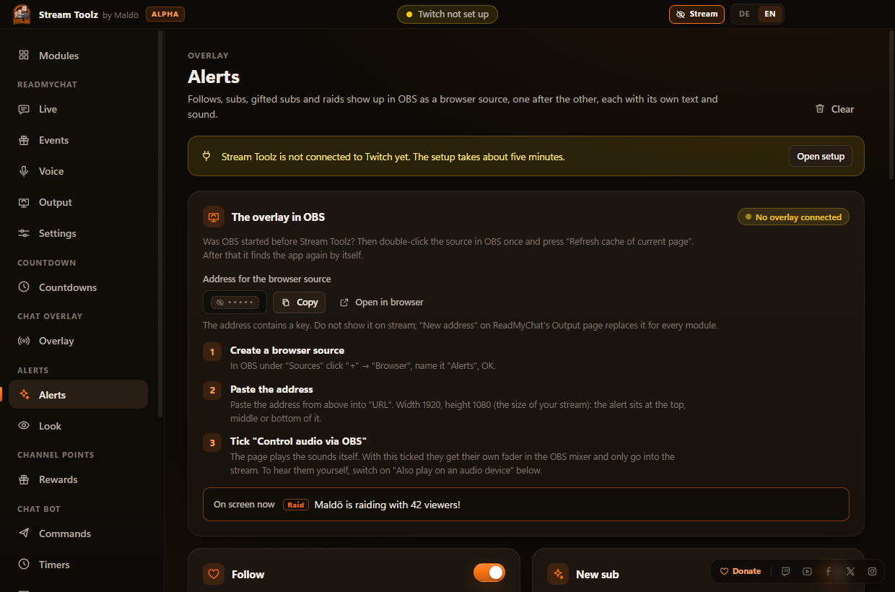

### Channel Points: a sound for every reward

Load your channel's rewards from Twitch and give each one a sound, a volume and a cooldown. When a viewer redeems it,
the sound plays, on the OBS browser source or on an audio device. A log shows the last redemptions and what happened
with each.

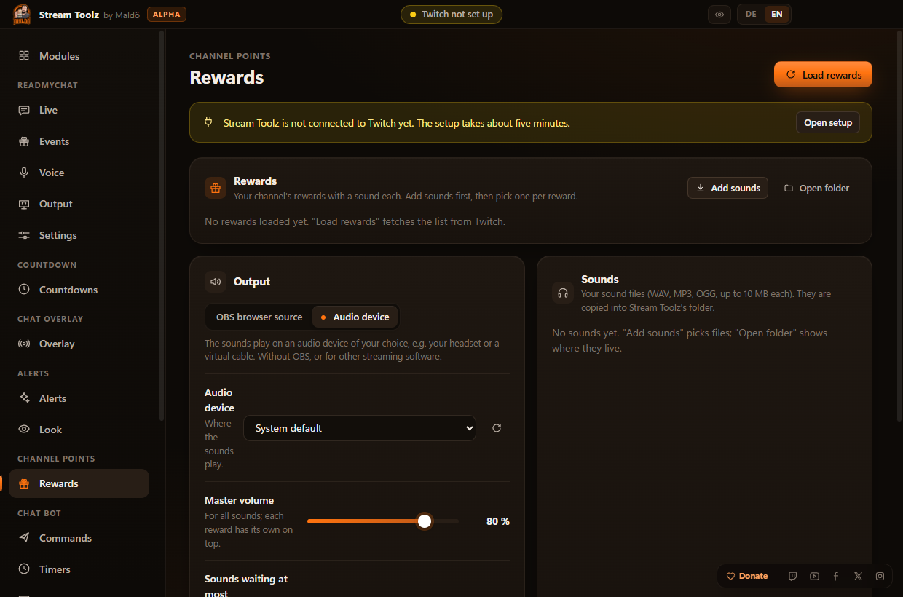

### Chat Bot: answers in your chat

Commands like `!discord`, `!specs` or `!so` answered in the chat as your own account, plus timed messages.

- **Commands** with aliases, placeholders ({user}, {channel}, {args}, {count}), who may use them (everyone, subs, VIPs,
  mods, you), a cooldown per command and per user, and a counter. `!commands` lists them.
- **Timed messages** every N minutes, only when the chat was active in between.
- **Plays by the rules:** at most one message every 1.5 seconds, a queue that never floods Twitch's limits, and the bot
  never answers itself.
- **Preview** every answer before it goes out, and a log of what the bot said and why.

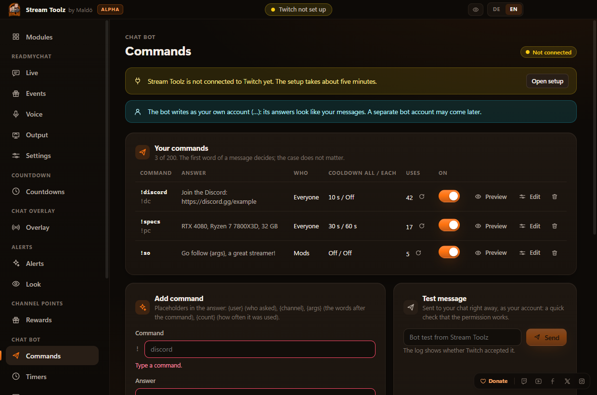

## Languages and voices

**The app speaks German (Deutsch) and English.** You pick the language at the first start, and the **DE | EN** switch
in the title bar changes it at any time. ReadMyChat reads both languages in one chat, each with its own voice. Every
spoken text ("sagt", the event announcements) comes from a language pack; another language is one JSON file in your
profile folder plus a voice that speaks it, see [language packs](docs/modules/readmychat-language-packs.md).

The voices run on your PC: Piper voices are a free download inside the app and then work offline; the Windows voices
need nothing at all. The Voice page lets you listen to each one before you choose.

## Good to know

> [!IMPORTANT]
> **Stream Toolz is a hobby project, and this is a beta.** It still has bugs, and things can change between versions.
> Your feedback helps a lot: [report a bug or an idea](https://github.com/nfMalde/stream-toolz/issues/new/choose).

- **Windows 10 or 11.** Linux and macOS come later.
- **Your own Twitch app.** Every streamer registers a small app of type "Public" in Twitch's developer console (the
  setup assistant shows every click) and enters only its Client ID. There is no secret, and no app of ours that Twitch
  could switch off for everyone. The login asks only for what the modules that are on need; the Chat Bot is the only
  module that writes.
- **Windows warns once when you install it,** because the installer is not signed yet. [Installing](#installing)
  shows what to click.
- **Streamer mode** hides the Client ID, the browser-source addresses and file paths, in case the app is on stream.
- **Your data stays with you:** no analytics, no tracking, no servers of ours, and the logs hold no chat messages or
  names ([Privacy](#privacy)).
- **Nothing plays over the chat voice and vice versa:** each output plays one clip at a time. A shared mixer for
  alerts and the voice is on the list.

## Contents

- **For users:** [Installing](#installing) · [First start](#first-start) · [OBS](#obs) · [What Stream Toolz is not](#what-stream-toolz-is-not) · [Reporting a bug](#reporting-a-bug) · [Privacy & monetization](#privacy--monetization) · [Docs](docs/)
- **For contributors:** [Contributing](#contributing) · [Build from source](#build-from-source) · [Layout](#layout)
- [License](#license) · [No warranty, no liability](#no-warranty-no-liability) · [Links and support](#links-and-support)

## Installing

Download `Stream-Toolz-Setup-<version>-x64.exe` from the **[releases page](https://github.com/nfMalde/stream-toolz/releases)**
and run it. It installs for your Windows user only (no admin rights) and starts the app; the installer puts a shortcut
on the desktop and in the Start menu.

> [!TIP]
> **New to GitHub?** You need no account. Open the releases page: the newest version is at the top. Scroll down to
> **Assets** below its description and click the `.exe` file; it downloads like any other file. The files named
> *Source code* are not needed.

**Windows SmartScreen** shows "Windows protected your PC" the first time, because the installer carries no signature
yet. Click **More info**, then **Run anyway**. You can check the file against `SHA256SUMS.txt` on the releases page, or
its build provenance with `gh attestation verify <file> --repo nfMalde/stream-toolz`.

Settings, the login and the voices live in `%APPDATA%\Stream Toolz` and stay when you update or uninstall.

## First start

The setup assistant opens by itself and takes about five minutes:

1. **Language** of the app and the chat.
2. **Your Twitch app:** the assistant opens Twitch's developer console for you, tells you what to fill in (type
   "Public", a name, any redirect URL) and takes the Client ID.
3. **Login:** the app shows a code, you confirm it on twitch.tv/activate, and the chat is connected. Twitch lists the
   permissions on that page: only what the modules that are on need.
4. **A voice:** pick a Windows voice, or download a Piper voice and listen to it.
5. **Output:** the OBS browser source or an audio device, and a test message.

Every step can be skipped and changed later on the pages.

## OBS

Each module that shows something in the stream gives you one **address for a browser source** on its page, with a
Copy button and the steps for OBS. The addresses contain a key, the same for every module: do not show them on stream
(streamer mode hides them), and "New address" on ReadMyChat's Output page replaces it everywhere. For the voice and
the alerts, tick **Control audio via OBS** on the source: then the sound goes only into the stream and gets its own
fader. The countdown can also write text files for an OBS text source, so OBS controls the font.

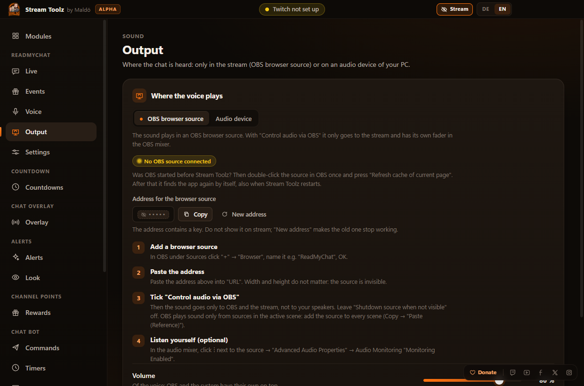

## What Stream Toolz is not

- **Not an AI, and it will not become one.** The voices are trained speech models that read the chat aloud, and the
  countdown's parser is a few hundred lines of rules for German and English. Nothing is generated, nothing about you
  or your viewers is sent anywhere to be analysed. An AI would need servers and money, and Stream Toolz stays free
  and local.
- **No servers: no accounts, no cloud, no dashboards.** A web service would mean hosting costs every month. Stream
  Toolz stays free, so there is none of that. Everything stays on your PC; the only internet connections are Twitch
  and the voice downloads you start yourself.
- **Not a second account.** The bot answers as your own Twitch account, through your own Twitch app. A separate bot
  account may come later.
- **Not an official product** of Twitch or OBS. Twitch's rules apply to what the app says in your name
  (see [No warranty, no liability](#no-warranty-no-liability)).

## Reporting a bug

Open a [bug report](https://github.com/nfMalde/stream-toolz/issues/new?template=bug_report.yml) and attach the newest
file from the **Logs** folder (Settings → Logs). The logs hold no chat messages, viewer names, tokens or keys; every
line is masked before it is written. Ideas go to [Idea or wish](https://github.com/nfMalde/stream-toolz/issues/new?template=feature_request.yml).

## Privacy & monetization

What leaves the PC, and only that: Twitch for the login, the chat and the events; GitHub and Hugging Face for the
voice downloads, only when you click Install, pinned and checked against a checksum; Twitch's emote pictures, only if
you switch them on in the Chat Overlay, loaded by OBS. No analytics, no update checks, no server of ours. The login is
stored encrypted with your Windows account's key. The details are in [docs/03-security.md](docs/03-security.md).

Stream Toolz is 100 % free. Donations are optional and bring no perks: every feature stays free for everyone, and
there are no ads, no premium tiers and no sponsored voices.

## Contributing

Bug reports, fixes, tests, translations and ideas are welcome: see [CONTRIBUTING.md](CONTRIBUTING.md) and the
[code of conduct](CODE_OF_CONDUCT.md). Security issues go to [SECURITY.md](SECURITY.md), never into a public issue.

Stream Toolz follows its older sibling [GT Toolz](https://github.com/nfMalde/gt-toolz), a coach for Gran Turismo 7
by the same author: the same "everything on your PC" idea, the same rules, and proven parts taken over.

## Build from source

Requirements: Node.js 22.23.2 (the version the CI uses), Windows 10/11.

```bash
npm ci                                  # install scripts are off (.npmrc)
node node_modules/electron/install.js   # fetch the Electron binary once
npm run dev                             # Angular dev server + Electron with live reload (dev profile)
npm test                                # unit tests (packages, modules, desktop)
npm run typecheck
npm run app                             # production build of UI and main process, then start
npm run release -- --unsigned           # build, tests and the Windows installer (docs/06-release.md)
```

End users never use npm or a terminal: everything (Twitch setup, voices, output) happens in the app.

## Layout

| Folder | What |
| --- | --- |
| `packages/core` | The shell's contract: app API, module contract, app settings, checks; no Electron |
| `packages/twitch` | Twitch: login by code, EventSub, Helix, chat messages, events and redemptions, the features modules read |
| `packages/speech` | Speech: Piper, Windows voices, optional voice packages (sherpa-onnx engine code kept for later) |
| `modules/readmychat` | ReadMyChat: the reader, filters, queue, language packs (`src`), its main-process part (`main`), its pages (`ui`) |
| `modules/countdown`, `chatoverlay`, `alerts`, `channelpoints`, `bot` | The other modules, each with the same layout; described in [docs/modules/](docs/modules/) |
| `apps/desktop` | Electron main process, the shell: windows, IPC, encrypted secrets, Twitch connection, local server (browser sources), audio outputs, shortcuts, the module host |
| `apps/ui` | Angular (zoneless, signals, NgRx Signal Stores), the shell: navigation, Modules, Twitch, app settings, About, setup assistant |
| `scripts/release` | The release: build, tests, the Windows installer, the release plan |
| `docs` | Plan, desktop app notes, security, modules, release checks, release |

See [docs/01-research-and-plan.md](docs/01-research-and-plan.md), [docs/02-desktop-app.md](docs/02-desktop-app.md), [docs/03-security.md](docs/03-security.md), [docs/04-modules.md](docs/04-modules.md), [docs/05-release-check.md](docs/05-release-check.md) and [docs/06-release.md](docs/06-release.md).

## License

Stream Toolz is free software: you can redistribute it and/or modify it under the terms of the
**[GNU General Public License v3.0](LICENSE)** as published by the Free Software Foundation.

Copyright (C) 2026 Malte Peters (Maldö)

Contributions are accepted under the [Contributor License Agreement](CLA.md). Third-party components and voices keep
their own licenses; they are listed in [THIRD-PARTY-NOTICES.md](THIRD-PARTY-NOTICES.md) and in the app under About.

## No warranty, no liability

Stream Toolz is provided as is, without warranty of any kind. Use it at your own risk: the author is not liable for
anything that happens on your stream, your Twitch account or your PC. Twitch's rules apply to what the bot says in
your name.

## Links and support

Stream Toolz is a project by Maldö and free for every streamer. If it helps you, a donation is welcome; it is
voluntary and comes without perks, as every feature stays free for everyone.

- Donate: [PayPal](https://www.paypal.com/donate/?hosted_button_id=SVZHLRTQ6H4VL)
- [Twitch](https://www.twitch.tv/maldoe) · [YouTube](https://www.youtube.com/@dermaldoe) · [Instagram](https://www.instagram.com/maldoe_gaming/) · [Facebook](https://www.facebook.com/RealMaldoe) · [X](https://x.com/DerMaldoe)

The logo and colours come from Maldö's stream assets; logo files and links are the same as in
[GT Toolz](https://github.com/nfMalde/gt-toolz).
